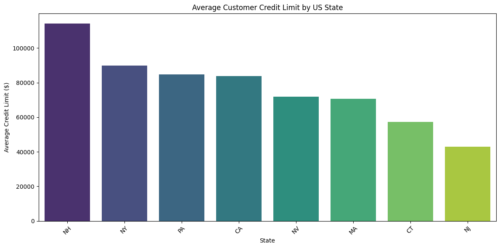
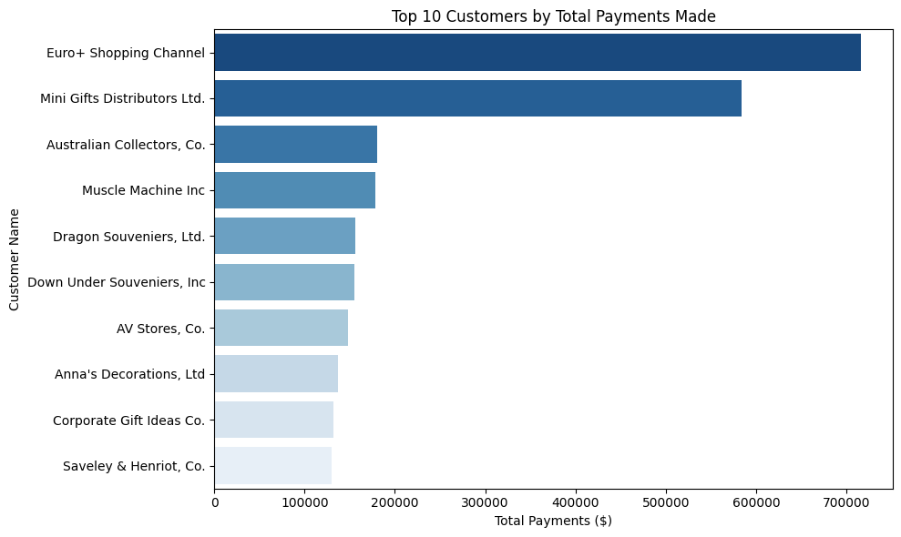
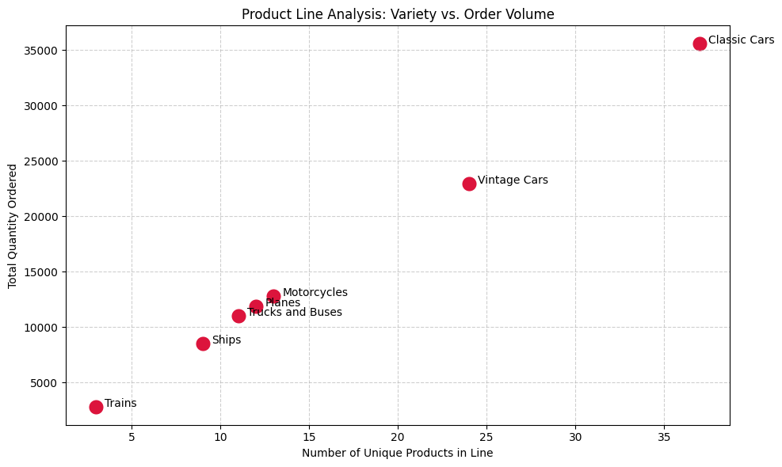
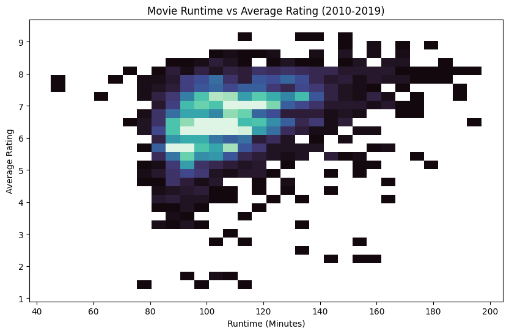
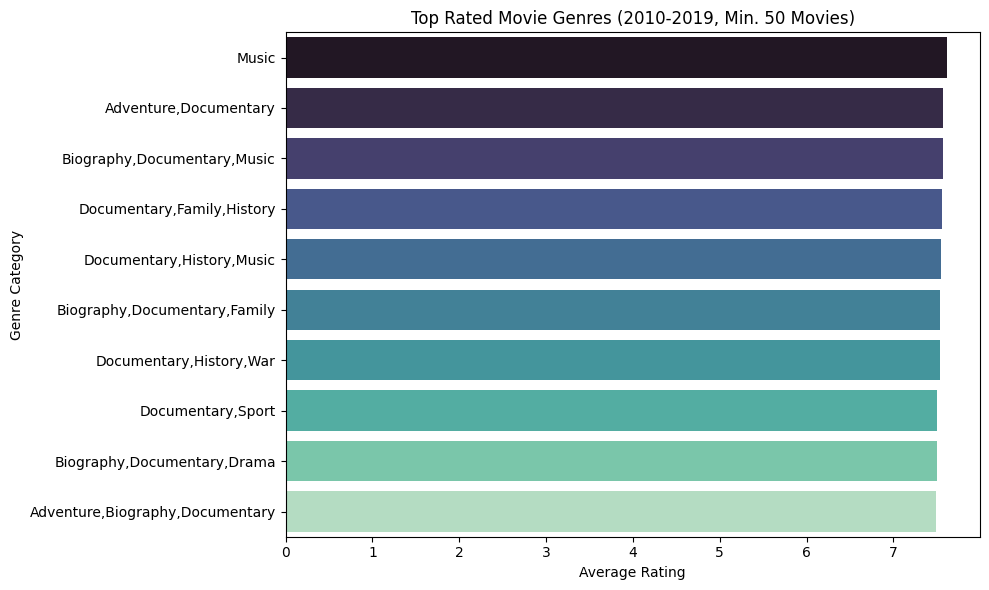

# Summative Lab: SQL Data Analysis

This repository contains a two-part exploratory data analysis project demonstrating intermediate-to-advanced SQL querying, data manipulation with pandas, and visualization using Seaborn and Matplotlib. 

## Project Overview

### Part 1: Guided SQL Series
Queries a business relational database (`data.sqlite`) to extract actionable commercial insights. Key operations include:

* Filtering target demographics, such as California high-credit customers and international clients for specialized campaigns.
* Aggregating financial and inventory metrics to visualize average credit limits by state and rank top customers by total payments.
  
  
  
  

* Analyzing product lines using scatter plots to determine the correlation between unique product variety and total order volumes.
  
  

* Using complex subqueries and multi-table joins to map reporting structures and identify employees working in small remote offices.

### Part 2: Exploratory Analysis with SQL
Explores a comprehensive IMDB database (`im.db`) to answer strategic business questions for production studios. Focus areas include:

* Investigating the relationship between movie runtime and average viewer ratings for mainstream films (10,000+ votes) released between 2010 and 2019.
  
  

* Mapping top-rated movie genres to establish baseline audience preferences during initial exploration.

  

* Outlining necessary data cleaning protocols, including dropping null values for runtimes and standardizing genre arrays and year integers prior to analysis.

## Technologies Used
* **Language:** Python 3
* **Libraries:** `sqlite3`, `pandas`, `matplotlib.pyplot`, `seaborn`, `zipfile`
* **Data Sources:** `data.sqlite` (Sales/Business Database) and `im.db.zip` (IMDB Movie Database)

## Setup and Execution
1. Ensure Python and the required visualization libraries (`pandas`, `matplotlib`, `seaborn`) are installed in your environment.
2. Place both `data.sqlite` and `im.db.zip` in the root directory. Ensure the `images/` folder is also in the root directory to render the visuals properly.
3. Run the notebook sequentially. The code will automatically unzip the IMDB database, establish the necessary SQLite connections, execute the queries, and render the visual plots inline.